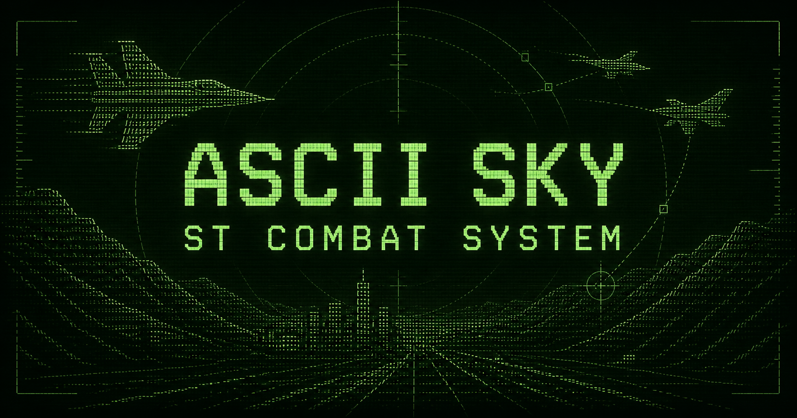

# Stellaria ASCII Air

> **LOCK THE SIGNAL. OWN THE SKY.**
> 锁住信号，掌控天空。



Stellaria ASCII Air is a standalone browser air-combat game. Its flight, terrain, sensors, weapons, damage, and collision systems run in a three-dimensional simulation, while the final image is presented as a dense ASCII tactical display.

它是一款可本地运行的 3D 空战 Web App：背后进行飞行、地形、传感器、武器、损伤与碰撞模拟，前台以 ASCII 战术显示器风格呈现。

## Highlights

- 120 Hz fixed-step flight simulation with mouse-instructor and direct keyboard controls
- Modern-jet energy, angle-of-attack, stall, spin, structural damage, and afterburner heat models
- SRC, TWS, ACM, HMD, and STT fire-control radar modes with clutter, masking, track coast, and lock loss
- Gun computing sight, infrared, semi-active radar, and active-radar missiles
- RWR, flare/chaff, terrain warnings, radar altitude, component damage display, and persistent crash view
- StSL-authored WebGPU post-processing with generated WGSL and a CPU/Canvas fallback
- A single-file offline build that can be opened directly in Chromium-based browsers

## Quick start

Requirements: Node.js 22.13 or newer.

For a ready-to-run copy, download either the standalone HTML or the complete ZIP bundle from [GitHub Releases](https://github.com/Stellaria-Studio/Stellaria-ASCII-Air/releases). The HTML can be opened directly in the latest Chrome, Edge, or Chromium.

```bash
npm ci
npm run dev
```

Production checks and build:

```bash
npm run lint
npx tsc --noEmit
npm run build
```

Build the offline, single-file Web App:

```bash
npm run build:standalone
```

Then open `release/ascii-sky-webapp/index.html` in the latest Chrome, Edge, or Chromium. No server is required.

## Controls

| Input | Action |
| --- | --- |
| Mouse | Aircraft-relative flight-control command |
| `W` / `S` | Push / pull |
| `A` / `D` | Roll left / right |
| `Q` / `E` | Rudder left / right |
| `Shift` / `Ctrl` | Increase / decrease throttle |
| `B` | Airbrake |
| `R` | Cycle radar mode |
| `T` / right mouse | Designate, lock, or cycle target |
| `H` | Helmet-mounted sight acquisition |
| `X` | Undesignate |
| `1`–`4` | Gun / IR / SARH / ARH weapon |
| Left mouse | Fire gun |
| `Space` | Fire selected missile |
| `F` / `G` | Flare / chaff |
| `Esc` | Pause and release pointer lock |

See the full [Chinese operation and systems guide](public/USER_GUIDE_CN.md) for HUD symbology, radar and sensor behavior, missile guidance, stall/spin recovery, damage, and tactics.

## Rendering architecture

- `shaders/ascii_post.stsl` is the source shader.
- `tools/build-shaders.mjs` emits `public/shaders/ascii_post.wgsl` for WebGPU.
- `engine/basic-web-core` supplies the portable camera/projection boundary used by the browser simulation.
- When WebGPU is unavailable, the game keeps running through its CPU/Canvas presentation path.

The aircraft and weapon names are fictional. The simulation is deliberately simplified from public concepts and is not a real-aircraft or weapons training system.

## License

Released under the [MIT License](LICENSE).
